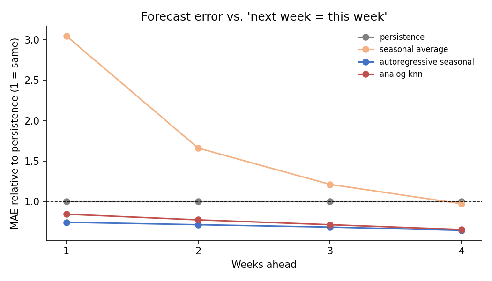
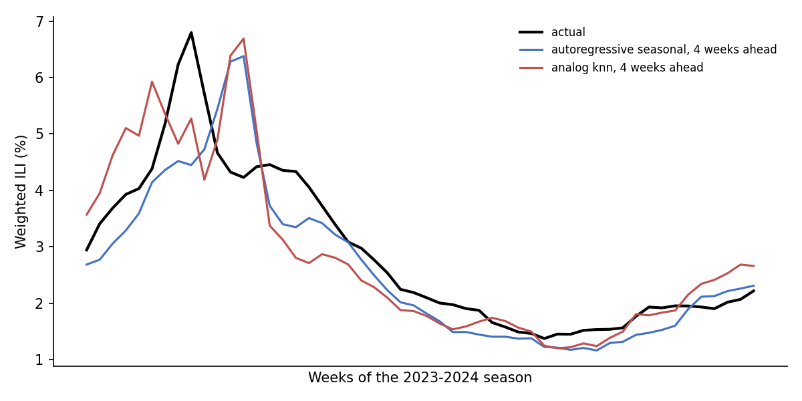

# Forecasting US flu activity 1 to 4 weeks ahead

Weekly influenza-like illness (ILI) in the US, forecast 1 to 4 weeks ahead with four simple models, tested the way a real forecaster would be: at each week, use only what was known then. Models are written from scratch with numpy.

## Data

CDC FluView, national weighted ILI (% of outpatient visits for flu-like illness), 2010 to 2025, through the CMU Delphi Epidata API (https://api.delphi.cmu.edu/epidata/). `src/fetch.py` downloads it, and the file is in `data/fluview_national.csv`.

## Models

1. Persistence: next week = this week. The baseline everything has to beat.
2. Seasonal average: the average value for that calendar week in all earlier years.
3. Autoregressive + seasonal: regression on the last 4 weeks of log ILI plus yearly sine and cosine terms, fitted separately for each horizon.
4. Analog (k-nearest-neighbour): find 8 earlier windows from the same time of year with a similar last 4 weeks, and average what happened next.

## How it was tested

Rolling origin from 2015 on: every model is refitted at each week using only targets that were known by then. The COVID disruption (epiweek 202010 to 202226) is left out of training and testing. Error is MAE in percentage points of weighted ILI.

## Results (MAE as a share of persistence; lower is better)

| Weeks ahead | Seasonal average | Analog | Autoregressive |
|---|---|---|---|
| 1 | 3.05 | 0.84 | 0.74 |
| 2 | 1.66 | 0.77 | 0.71 |
| 3 | 1.21 | 0.71 | 0.68 |
| 4 | 0.97 | 0.65 | 0.64 |

- The autoregressive model cuts error against persistence by 26% at 1 week and 36% at 4 weeks. The analog model is close behind. The seasonal average alone is useless at short horizons and only matches persistence at 4 weeks.
- It beats persistence in nearly every season (4 weeks ahead). The exceptions: 2019 is close (autoregressive 1.13 vs persistence 1.29), and in the 2021 season the autoregressive model is worse than persistence (0.73 vs 0.58). The analog model holds up better there (0.32).
- Peaks are the weak spot. Four weeks ahead, forecasts made before the peak stay well below its height (`data/peak_forecasts_4wk.csv`). In 2017 the peak was 7.5%; persistence said 5.8, autoregressive 4.6, analog 4.0. The plot below shows forecasts that arrive late at the peak. Low average error does not mean it catches the peak, and the peak is what a hospital plans for.




## Limits

- The data are the latest revised values. A real forecaster sees early reports that get revised later, so real-time accuracy would be worse.
- National level only. State-level forecasts are harder.
- Seasons here are partly cut by the pandemic exclusion, so by-season numbers cover different numbers of weeks (`data/mae_by_season_4wk.csv`, per-forecast file `data/forecasts.csv` not stored here, run the script to create it). The 2014 and 2019 rows are partial seasons.
- Simple models. Proper forecast hubs score probabilistic forecasts with intervals. Mine are point forecasts only.
- The k and lag settings were chosen by hand and not tuned.

## Run it

```
pip install numpy pandas requests matplotlib
python src/fetch.py
python src/analyze.py
```
